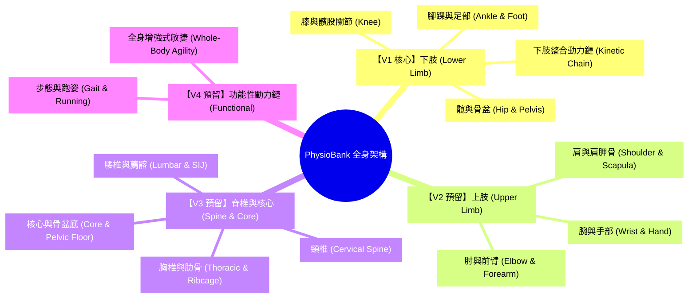
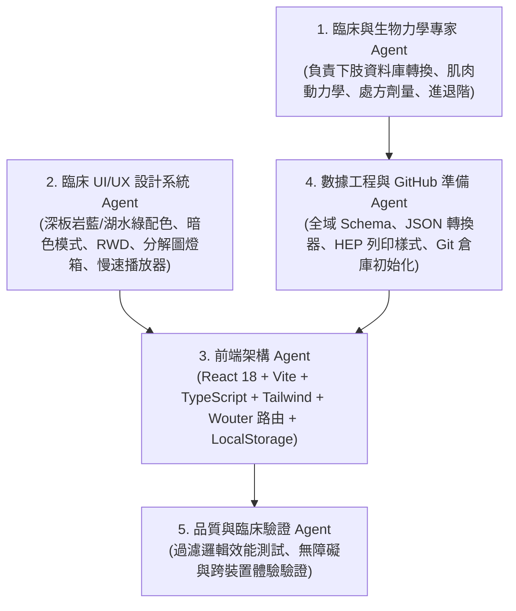

# 物理治療全身復健運動庫 (PhysioBank) - 系統架構與 V1 (下肢) 實施計畫

> **目標**：打造現代化、可擴展至全身 (Whole-Body) 的物理治療臨床運動處方與教學資料庫。  
> **V1 核心範疇**：下肢四大複合體（髖與骨盆、膝與髕股、腳踝與足部、下肢整合動力鏈）完整實作，支援多角度圖片/分解圖燈箱、慢動作影片播放器、分期協定、HEP A4 列印與自訂匯出。

---

## 一、 目標與全身架構演進藍圖 (Whole-Body Roadmap)



### 1. 全身雙層解剖分類 (Two-Tier Anatomical Taxonomy)
- **MacroRegion**：Lower Limb (V1), Upper Limb (V2), Spine & Core (V3), Full Body & Functional (V4)
- **SubRegion**：細分 14 個專業物理治療臨床子區域。
- **UI 呈現**：首頁與檢索抽屜完整顯示全身版圖。V1 下肢顯示真實運動數量與進入點；V2-V4 標註「擴充預留（支援自訂新增）」標籤。

### 2. 每個運動必備四大模組 (The 4 Core Modules)
1. **目標肌群與生物力學剖析**：主動肌、協同肌、穩定肌、動作平面（矢狀面、額狀面、水平面、多平面）、開閉鎖動力鏈 (OKC/CKC)。
2. **分步動作指南**：起始姿勢、結構化步驟（Step 1, Step 2...）、分解圖示、防代償重點、臨床指導口訣 (Coaching Cues)、常見錯誤動作。
3. **圖片示範**：總覽主圖、多角度畫廊、肌群解剖圖示，並為各步驟提供**分解圖片燈箱 (Lightbox)** 與**智慧解剖 SVG 佔位渲染**。
4. **影片示範**：內建自適應播放器（本地 `.mp4`/`.webm`、GIF、YouTube/Vimeo 嵌入），具備 **0.5x / 0.75x 慢動作播放**、**循環播放 (Loop Toggle)**、時間軸快轉與全螢幕放大功能。

---

## 二、 多智能體分工協同 (Multi-Agent Roles)



---

## 三、 多視圖系統架構（拒絕單一畫面）

1. **`/library` (或 `/`) - 運動總覽與全身檢索中心**：
   - 全域搜尋列（運動名、中英文肌肉名、適應症、器材）。
   - 全身部位雙層導覽選單（V1 下肢為主要入口）。
   - 側欄多維度過濾抽屜（收縮型態、復健分期、器材、難易度、動力鏈）。
   - 運動卡片網格（縮圖、解剖部位徽章、難度星級、快速加入 HEP）。
2. **`/exercise/:id` - 深度臨床詳情頁**：
   - 頂部臨床標頭與標籤。
   - 內建慢動作/循環影片播放器與多角度圖片畫廊。
   - 生物力學面盤（肌群關係與關節運動學）。
   - 分步執行說明卡片（含步驟分解圖與點擊放大 Lightbox）。
   - 互動式進退階樹（可直接點擊跳轉至關聯運動）。
   - 臨床劑量、紅旗禁忌症與治療師筆記。
3. **`/protocols` - 分期復健協定學習庫**：
   - 預載下肢三大核心協定（例如：PFPS 髕骨股骨疼痛、ACL 術後分期復健、外側踝扭傷 PEACE & LOVE 協定）。
   - 支援將特定分期的所有運動一鍵匯入 HEP 組裝器。
4. **`/builder` - 互動式 HEP 組裝器與 A4 臨床列印模組**：
   - 自由排列運動順序、自訂病患劑量與治療師個別化口訣。
   - 提供 A4 臨床病患居家運動計畫 (HEP) 專用列印與 PDF 匯出版面（自動隱藏導航與操作元件）。
5. **`/custom` - 自訂運動與媒體管理工作室**：
   - 視覺化表單，可為全身任何部位新增自訂運動。
   - 支援綁定本地媒體路徑（`/media/...`）或外鏈。
   - 支援匯出/匯入完整 JSON，便於將自訂內容提交 `git commit`。

---

## 四、 專案結構與 GitHub 整備規劃

```
physio-bank/
├── public/
│   ├── media/
│   │   ├── lower-limb/
│   │   │   ├── hip/
│   │   │   ├── knee/
│   │   │   └── ankle/
│   │   └── diagrams/
│   └── favicon.ico
├── src/
│   ├── components/
│   │   ├── common/           # Button, Modal, Badge, Lightbox, VideoPlayer
│   │   ├── layout/           # Navbar, Footer, WholeBodyNav
│   │   ├── library/          # ExerciseCard, FilterDrawer, SearchBar
│   │   ├── detail/           # BiomechanicsPanel, StepGuide, ProgressionTree
│   │   ├── protocols/        # ProtocolCard, PhaseTimeline
│   │   └── builder/          # RoutineList, DosageEditor, HepPrintView
│   ├── data/
│   │   ├── lowerLimbExercises.ts   # 100% 完整轉換的下肢資料庫
│   │   └── lowerLimbProtocols.ts   # 下肢臨床復健協定
│   ├── types/
│   │   └── exercise.ts       # 全身可擴充 TypeScript Schema
│   ├── store/
│   │   └── useRoutineStore.ts # LocalStorage 狀態管理
│   ├── App.tsx               # 路由切換 (wouter)
│   ├── main.tsx
│   └── index.css             # Tailwind 樣式與 @media print 列印樣式
├── index.html
├── package.json
├── tailwind.config.js
├── tsconfig.json
├── vite.config.ts
└── README.md                 # 完整說明文件，適合開源至 GitHub
```

---

## 五、 當前待確認項目 (User Review & Input)

> [!IMPORTANT]
> **檔案確認**：您在指令中提到「我已經上傳了我整理的 Lower Limb Exercise Bank 文件」，目前本機目錄內尚未看到該實體檔案。
> 1. 請檢查是否已將檔案放置於專案資料夾中（`/Users/harryng/Downloads/AI gen auto tool/Physio website/`）。
> 2. 或您可以直接將該文件的文字內容貼在對話中。
> 
> 一旦取得該文件，我們將立即：
> 1. 執行專案初始化（Vite + React + Tailwind + Lucide + 慢速循環影片組件）。
> 2. 100% 忠實將該文件轉換為型別嚴謹的 `lowerLimbExercises.ts`。
> 3. 啟動本機開發伺服器進行驗證，並初始化 Git 儲存庫準備推送至 GitHub！
